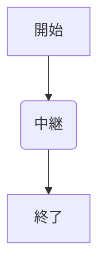

+++
title =  "Sample"
date = 2099-10-24T08:56:34+09:00
draft = true
tags = []
featured_image = "/images/article_cat.jpeg"
description = "ここに説明文（リストに表示されます）"
aliases = ["/post/articles/sample"]
features = ["katex", "mermaid"]
+++

ローカルで表示を確認する際は、オプションとして`-DF`を付けるとこの記事が表示されます。

# サンプル記事
`articles`セクションのサンプル記事です。

[外部リンク(google)](https://www.google.co.jp/)

[内部リンク](../../news/sample/)

# KaTeX
これはディスプレイ表示です:

$$\int_a^bx\,\mathrm{d}x$$
\[e^x=\sum_{n=0}^\infty \frac{x^n}{n!}\]

これはインライン表示です: \(e^{i\theta}=\cos\theta+i\sin\theta\)

# Mermaid
